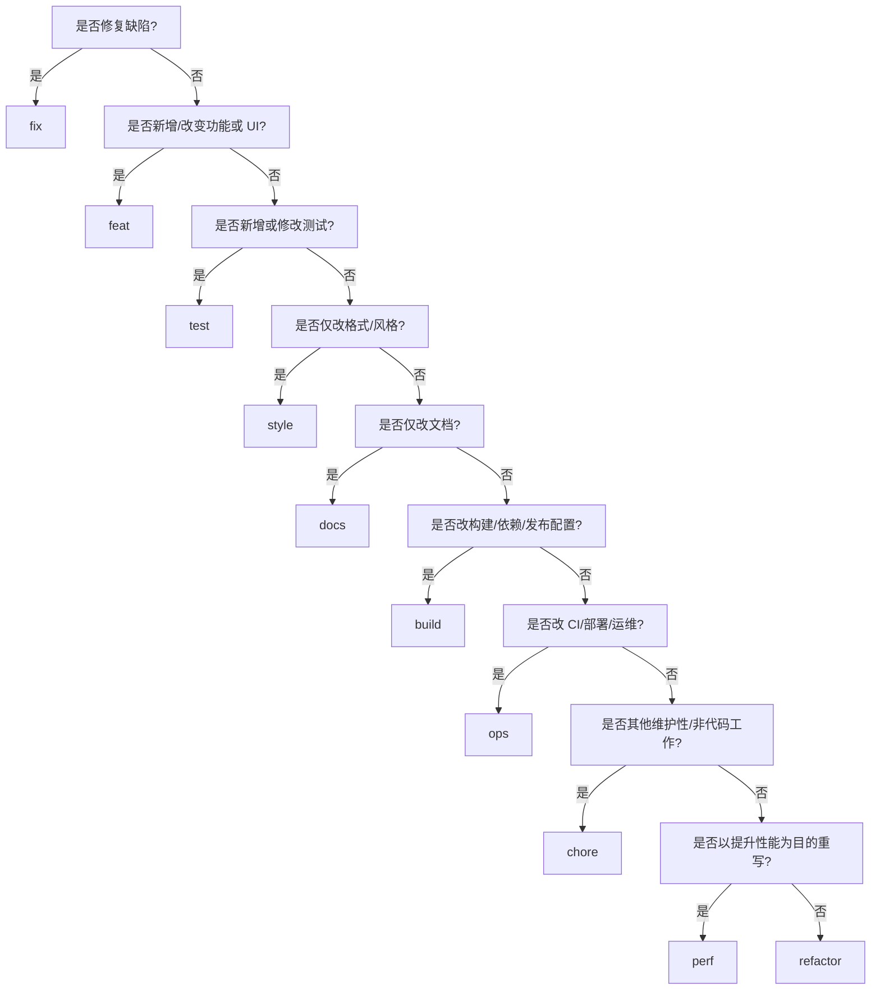

# 提交信息规范：Conventional Commits（AI 参考）

本文件是本仓库 AI 辅助提交的**提交信息唯一事实源**（source of truth）。人工提交可省略 AI 生成脚注，见 `CONTRIBUTING.md`。上游 cherry-pick / adapt 的提交标题保持原样，见 `.agents/skills/sync-upstream/SKILL.md`。Agent 可以创建提交、Issue、PR，但**不得** merge，见 `AI_POLICY.md` 与 `.agents/shared/ai-contribution/REFERENCE.md`。

> 语言约定：`type` / `scope` / `!` / 脚注键名一律用英文；`description` 与正文用**简体中文**（贴合本仓库既有提交历史，如 `docs: 精简 README，聚焦部署与使用说明`）。

## 1. 标题格式（Header）

```text
<type>(<可选 scope>): <描述>
```

示例：

```text
feat(panel): 新增任务中心全账号扫描
fix(upstream): 剔除 function.name 为空的 tool_call
docs: 补充 Docker 部署说明
```

规则：

- `type` 必填。
- `scope` 可选，用本仓库既有、有意义的模块名，如 `server`、`pool`、`panel`、`upstream`、`auth`、`scheduler`、`session`、`config`、`build`。
- **不要**把 issue 编号当 scope，用脚注（如 `Fixes #123`）。
- `description` 必填。
- 破坏性变更在 `:` 前加 `!`：

```text
feat(config)!: 移除 max_body_mb 配置项
```

## 2. 选择 type

按**主要意图**归类，按以下顺序判断：



| Type       | 适用场景                                             | 不适用场景                       |
| ---------- | ---------------------------------------------------- | -------------------------------- |
| `feat`     | 新增、修改、移除用户可见 / API 行为                  | 只是修既有缺陷                   |
| `fix`      | 修正既有 API / UI 行为的缺陷                         | 新增能力                         |
| `refactor` | 重构代码，不改变对外 / API / UI 行为                 | 主要目的是性能提升               |
| `perf`     | 提升性能、内存、延迟、吞吐，不改变预期行为           | 一般性清理                       |
| `test`     | 新增、修正、更新测试                                 | 产品代码变更是主要目的           |
| `style`    | 格式、空白、仅 lint、分号、import 排序等，无行为变化 | 代码结构调整或功能变化           |
| `docs`     | 仅文档变更                                           | 含任何代码 / 配置行为变化        |
| `build`    | 构建系统、打包、依赖、项目版本、发布构建组件         | 部署、基础设施、CI/CD、监控、备份 |
| `ops`      | 基础设施即代码、部署脚本、CI/CD、备份、监控、运维配置 | 本地开发工具或包 / 构建依赖      |
| `chore`    | 维护性或非代码工作，如初始化、`.gitignore`           | 有更精确的 type 适用             |

## 3. 描述规则

写简洁的命令式描述。

- 用现在时命令式：`新增`、`修复`、`移除`、`更新`、`避免`。
- 心里默念：「本次提交将……」。
- 英文 type/scope 小写；中文描述正常书写。
- 结尾不加句号。
- 陈述结果或意图，而非实现琐碎细节。
- 标题聚焦单一逻辑变更。

推荐：

```text
fix(pool): 避免冷却期账号被重复选中
feat(panel): 新增模型档位探测面板
perf(usage): 降低逐请求用量记录的锁竞争
```

避免：

```text
修复了 bug                          # 缺 type，含糊
feat: 改了些东西                     # 含糊
update files                        # 无 type 且缺上下文
fix: 修复了那个问题                  # 冗余且含糊
```

## 4. 正文（Body）与脚注（Footer）

用空行分隔标题、正文、脚注。

```text
<type>(<可选 scope>): <描述>

<可选正文>

<可选脚注>
```

### 正文

当标题无法说明动机、重要权衡或与旧行为的差异时使用正文。用现在时命令式。

```text
fix(auth): 刷新后复用 refresh-token 时使旧 token 失效

刷新 token 被使用后即失效该 token 家族，重放的 token 无法再创建
新的有效会话。
```

### 脚注

用于 issue 引用、破坏性变更详情、AI 生成元数据。

```text
feat(config)!: 移除旧版配置键

统一改用新键名。

BREAKING CHANGE: 客户端必须使用 listen 而非旧键 addr
Fixes #123
AI-Generated: true
Generated-At: 2026-08-25T20:34:00Z
```

破坏性变更规则：

- 必须在标题冒号前加 `!`。
- 必须包含 `BREAKING CHANGE:` 脚注，除非标题/正文已充分说明；建议始终写。
- `BREAKING CHANGE:` 必须原样书写（英文）。

## 5. AI 生成元数据

当 AI 生成、提议或最终确定提交信息时，附上 UTC 生成时间并显式标注 AI 生成。

用以下命令取时间：

```sh
date -u '+%Y-%m-%dT%H:%M:%SZ'
```

结果作为脚注追加，位于 issue 引用与 `BREAKING CHANGE:` 之后：

```text
AI-Generated: true
Generated-At: <UTC ISO 8601 时间戳>
```

规则：

- 仅用 UTC，格式 `YYYY-MM-DDTHH:MM:SSZ`。
- 在 AI 准备最终提交信息时生成时间戳。
- 保持在脚注区，与正文用空行分隔。
- 不要把时间戳或 AI 署名放进标题。
- 保留标准 Conventional Commits 字段；AI 元数据是额外的项目元数据。

示例：

```text
fix(server): 避免重复投递 webhook

拒绝已处理过的投递标识。

Fixes #482
AI-Generated: true
Generated-At: 2026-08-25T20:34:00Z
```

## 6. 特殊提交格式

merge 与 revert 提交沿用 Git 标准格式，不强制普通标题格式。

```text
chore: init
```

```text
Merge branch 'feat/panel'
```

```text
Revert "feat(auth): 新增 passkey 登录"
```

## 7. AI 生成流程

生成提交信息前：

1. 识别每个改动文件，及其用户可见 / API 可见 / 运维 / 测试 / 维护层面的结果。
2. 用决策流程选出最精确的主要 type。
3. 仅当 scope 是本仓库既有或明确有意义时才选。
4. 判断是否存在兼容性破坏。有则用 `!` 加 `BREAKING CHANGE:` 脚注。
5. 写一条小写命令式描述，结尾无标点。
6. 仅在有动机、行为对比、约束或非显然后果时加正文。
7. issue 引用只放脚注。
8. 运行 `date -u '+%Y-%m-%dT%H:%M:%SZ'`，在脚注追加 `AI-Generated: true` 与 `Generated-At: <结果>`。

当一个提交包含不相关改动时，建议拆分为多个提交。若无法拆分，选择最能代表主要目的的 type，并在正文说明次要影响。

## 8. 示例

```text
feat: 新增面板运行日志实时查看
```

```text
feat(panel): 新增积分到期提醒卡片
```

```text
fix(upstream): 修正请求体校验和计算
```

```text
fix: 补齐服务调用缺失参数

传入租户标识，使下游能解析正确配置。

AI-Generated: true
Generated-At: 2026-08-25T20:34:00Z
```

```text
perf(pool): 用位图降低可用账号扫描开销
```

```text
refactor(scheduler): 用表驱动重构时段判定
```

```text
style: 删除多余空行
```

```text
test(server): 覆盖非法 Bearer 签名
```

```text
build: 升级依赖
```

```text
ops(ci): 缓存 Go module 加速 nightly 构建
```

```text
chore: 更新 gitignore
```

## 9. 校验清单

返回提交信息前，确认：

- 标题符合 `<type>(<可选 scope>): <描述>`。
- type 属于：`feat`、`fix`、`refactor`、`perf`、`style`、`test`、`docs`、`build`、`ops`、`chore`。
- scope 可选、有意义、且非 issue 编号。
- 描述简洁、命令式、结尾无句号。
- 破坏性变更在 `:` 前有 `!`。
- 破坏性变更在需要时含 `BREAKING CHANGE:` 脚注。
- issue 编号只出现在脚注，如 `Fixes #123`。
- AI 生成的信息含 `AI-Generated: true` 与当前 UTC `Generated-At:` 脚注。
- 所选 type 反映主要意图，而非仅仅触及的文件。

## 10. 版本与发布（本项目特有）

**本项目采用滚动更新（rolling release），不使用语义化版本号，也不做带版本的 Release。** 因此：

- 不要用提交信息推导 major / minor / patch 版本号；Conventional Commits 在这里只用于**可读的变更分类**，不驱动版本自动化。
- 发布产物只有 **nightly 构建**（见 `.github/workflows/`）；版本串在**编译时注入**（构建期写入二进制），不作为可比的发布版本。
- 因此不存在「版本号提交」这类提交；`build`/`ops` 类提交仅描述构建/CI 改动本身。

> 例外：从上游吸收的历史版本号提交，其标题按 sync-upstream 技能保持原样（`cherry-pick`/`adapt`），但本仓库**不据此**建立自己的版本线。
